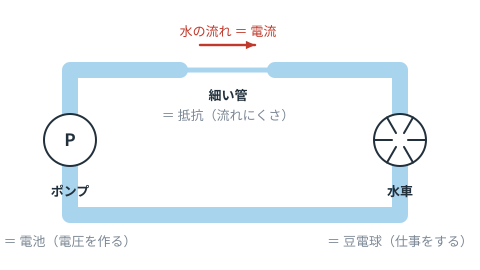
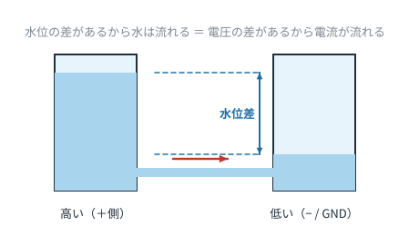

# 第0章　電気を「水」でイメージする

**この章のゴール**
- 電圧・電流・抵抗を、water（水）のイメージで直感的につかむ
- 「回路」とは何かを説明できる
- 感電・発火を避けるための最低限のルールを知る

---

## 0-1. 電気は目に見えない。だから水に置き換える

電気の勉強でつまずく最大の理由は、**目に見えないから**です。
そこで昔から使われているのが「水流モデル」です。完璧なたとえではありませんが、初心者のうちはこれで十分戦えます。

対応関係はこうです。

| 電気の世界 | 水の世界 | ひとことで言うと |
|---|---|---|
| **電圧**（V：ボルト） | 水位の差・水圧 | 押す力の強さ |
| **電流**（A：アンペア） | 流れる水の量 | どれだけ流れているか |
| **抵抗**（Ω：オーム） | 管の細さ | 流れにくさ |
| **電池・電源** | ポンプ | 圧力を作る装置 |
| **豆電球・モータ** | 水車 | 流れを使って仕事をするもの |
| **電線** | 太いパイプ | ほぼ抵抗ゼロの通り道 |

---

## 0-2. 電圧は「差」でしかない

ここが最初の関門です。

**電圧は、ある1点だけでは決まりません。必ず2点の「差」です。**

水槽の水位が高くても、隣の水槽の水位が同じなら水は流れません。
同じように、電池の＋側と−側に**差がある**から電流が流れます。

> 「この点の電圧は5V」と言うとき、実は「**GND（基準点）から見て**5V」という意味です。
> GND については第4章でしっかりやります。今は「電圧は差」とだけ覚えてください。

---

## 0-3. 「回路」＝ぐるっと1周つながった道

**回路（circuit）** の circuit は「circle（円）」と同じ語源で、「1周」という意味です。

電流は、電源から出て、部品を通って、**電源に戻ってこられないと流れません**。
途中で線が切れていたら、水が流れないのと同じで、何も起きません。

これは初心者が回路を動かせないときの原因の**第1位**です。
「あれ、光らない」と思ったら、まず**1周つながっているか**を目で追ってください。

---

## 0-4. 安全のお約束（これだけは守ってください）

電子工作の範囲（乾電池・USB電源・5V/12Vのアダプタ）なら、基本的に感電の心配はほぼありません。危険なのは次のケースです。

| ⚠️ やってはいけないこと | 何が起きるか |
|---|---|
| **コンセント（100V）の配線を自分でいじる** | 感電。命に関わる。資格が必要な作業もある |
| 電池の＋と−を直接つなぐ（ショート） | 大電流が流れて発熱・発火。リチウム電池は特に危険 |
| 電解コンデンサの＋−を逆に挿す | 発熱して破裂することがある |
| LEDを抵抗なしで電源につなぐ | 一瞬で焼き切れる（第7章で理由を説明します） |
| モータやリレーをトランジスタで直接ON/OFFする（保護なし） | 逆起電力で部品が壊れる（第6章） |

そして最強のルール：

> **配線を変えるときは、必ず電源を切ってから。**

---

## 0-5. この章のまとめ

- 電圧＝押す力、電流＝流れる量、抵抗＝流れにくさ
- 電圧は必ず「2点の差」
- 回路はぐるっと1周つながって初めて動く
- 100Vは触らない、ショートさせない

---

## 演習問題

**問1.** 水流モデルで、次のものは電気の何にあたりますか。
（a）ポンプ　（b）細い管　（c）流れている水の量

解答を見る

（a）電池・電源（電圧を作るもの）
（b）抵抗
（c）電流

**問2.** 豆電球と電池を線でつないだのに、豆電球が光りません。テスターも何もない状態で、まず何を確認しますか。

解答を見る

**電流の通り道が1周つながっているか**を目で追って確認します。
配線の外れ、断線、電池の入れ忘れ、スイッチが切れている……などが原因の大半です。
（電池切れや豆電球の球切れも同じく「道が途切れている」状態と考えられます）

**問3.** 「A点の電圧は3Vです」という文には、実は省略されている情報があります。それは何でしょう。

解答を見る

**どこを基準にして3Vなのか**（＝どの点との差なのか）。
ふつうは GND（0V の基準点）から見た値、という約束になっています。

---

⬅️ [目次に戻る](README.md) ／ ➡️ [第1章：電圧・電流・抵抗とオームの法則](ch01-vir.md)
