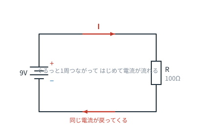
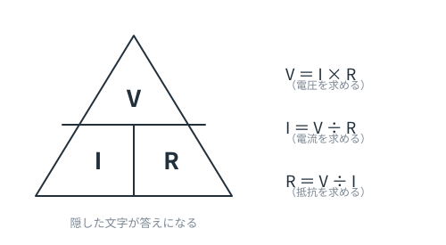
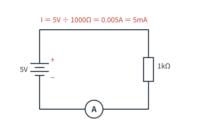
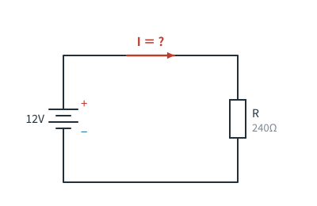

# 第1章　電圧・電流・抵抗とオームの法則

**この章のゴール**
- V・I・R の3つを使い分けられる
- オームの法則で計算できる
- 単位の接頭語（k, m, µ）に慣れる

---

## 1-1. 主役は3人だけ

電気回路の話の9割は、この3つで進みます。

| 記号 | 名前 | 単位 | イメージ |
|---|---|---|---|
| **V** | 電圧（Voltage） | V（ボルト） | 押す力 |
| **I** | 電流（Current） | A（アンペア） | 流れる量 |
| **R** | 抵抗（Resistance） | Ω（オーム） | 流れにくさ |

> 電流が I なのは、フランス語の intensité（強さ）に由来します。C じゃないので混乱しがちですが、慣れます。

---

## 1-2. いちばん基本の回路



電池（9V）と抵抗（100Ω）を1周つないだ、これ以上ないシンプルな回路です。

読み方はこうです。

1. 電池が 9V の「押す力」を作っている
2. その力が抵抗にかかる
3. 抵抗の「流れにくさ」に応じた電流が流れる
4. 電流は電池に帰ってくる（**同じ量**が帰ってきます。途中で減りません）

> ⚠️ よくある誤解：「抵抗を通ると電流が減る」——**減りません**。
> 減るのは**電圧**です。電流は1本道ならどこでも同じです。ここは第3章でもう一度やります。

---

## 1-3. オームの法則

3人の関係は、たった1本の式で決まります。

```
V ＝ I × R
```

覚え方は、この三角形です。**求めたい文字を指で隠すと、残りが答えの形**になります。



| 求めたいもの | 式 | 使う場面 |
|---|---|---|
| 電圧 V | V = I × R | 抵抗に何ボルトかかるか知りたい |
| 電流 I | I = V ÷ R | 何アンペア流れるか知りたい（**いちばんよく使う**） |
| 抵抗 R | R = V ÷ I | 何オームの抵抗を選べばいいか知りたい |

### 計算してみる



5V の電源に 1kΩ（＝1000Ω）の抵抗をつないだとき：

```
I = V ÷ R = 5 ÷ 1000 = 0.005 A = 5 mA
```

「5V に 1kΩ をつなぐと 5mA」——これは**暗記する価値のある基準値**です。
これさえ覚えておけば、「10kΩ なら 0.5mA」「100Ω なら 50mA」と、暗算で見当がつきます。

---

## 1-4. 単位の接頭語に慣れる

回路の世界では、そのままの数字はほとんど出てきません。

| 接頭語 | 読み | 倍率 | 例 |
|---|---|---|---|
| M | メガ | ×1,000,000 | 1MΩ = 1,000,000Ω |
| k | キロ | ×1,000 | 4.7kΩ = 4,700Ω |
| （なし） | — | ×1 | 100Ω |
| m | ミリ | ÷1,000 | 20mA = 0.02A |
| µ | マイクロ | ÷1,000,000 | 100µF = 0.0001F |
| n | ナノ | ÷10億 | 10nF |
| p | ピコ | ÷1兆 | 22pF |

**計算するときは必ず、いったん基本単位（V・A・Ω）に直してから**やるのが事故を防ぐコツです。

> 実際の回路図では「4.7k」「2k2」のように Ω が省略されたり、小数点の代わりに単位が入ったりします（`2k2` = 2.2kΩ、`4R7` = 4.7Ω）。

---

## 1-5. 電力（W）も少しだけ

抵抗に電流を流すと、必ず**熱**が出ます。その量が電力です。

```
P ＝ V × I
```

たとえば 3V が抵抗にかかって 10mA 流れているなら、`3 × 0.01 = 0.03W`。
市販の抵抗はふつう **1/4W（0.25W）** なので、余裕でOKです。

この計算をサボると、抵抗が焦げます。「なんか焦げくさい」の原因はだいたいこれです。

---

## 1-6. この章のまとめ

- V = I × R。指で隠せば形が出てくる
- 電流は1本道なら減らない。減るのは電圧
- 5V に 1kΩ → 5mA を基準として体に入れる
- 計算前に単位を揃える

---

## 演習問題

**問1.** 次の回路で流れる電流 I は何 mA ですか。



<details>
<summary>解答を見る</summary>

```
I = V ÷ R = 12 ÷ 240 = 0.05 A = 50 mA
```

**答え：50mA**

</details>

---

**問2.** 5V の電源に 220Ω の抵抗をつなぎました。
（a）流れる電流は？　（b）抵抗が消費する電力は？　（c）1/4W の抵抗を使って大丈夫？

<details>
<summary>解答を見る</summary>

（a）`I = 5 ÷ 220 ≈ 0.0227A ≈ 23mA`
（b）`P = V × I = 5 × 0.0227 ≈ 0.11W`
（c）0.11W < 0.25W なので **大丈夫**。ただし余裕は2倍ちょっとなので、抵抗はほんのり温かくなります。

</details>

---

**問3.** ある抵抗に 3V の電圧をかけたら 15mA 流れました。この抵抗は何Ωですか。

<details>
<summary>解答を見る</summary>

```
R = V ÷ I = 3 ÷ 0.015 = 200 Ω
```

**答え：200Ω**（mA を A に直すのを忘れずに）

</details>

---

**問4.** 次のうち、電流がいちばん多く流れるのはどれですか。
（a）5V・1kΩ　（b）12V・10kΩ　（c）3.3V・100Ω

<details>
<summary>解答を見る</summary>

（a）5mA　（b）1.2mA　（c）33mA

**答え：（c）**
電圧が高い＝電流が多い、とは限りません。**電圧と抵抗の組み合わせ**で決まります。

</details>

---

⬅️ [第0章](ch00-start.md) ／ [目次](README.md) ／ ➡️ [第2章：回路図の読み方](ch02-schematic.md)
