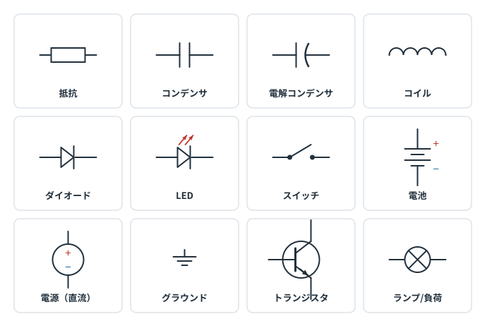
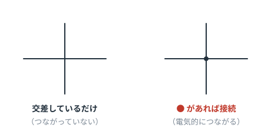
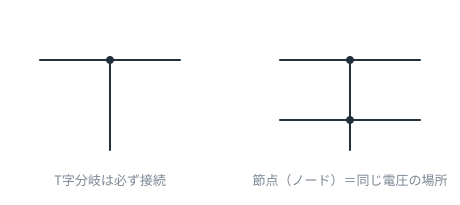
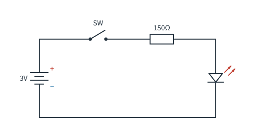

# 第2章　回路図の読み方

**この章のゴール**
- 主要な部品記号がわかる
- 線が「つながっている／いない」を見分けられる
- 回路図を読むときの手順を身につける

---

## 2-1. 回路図は「地図」であって「配置図」ではない

まずこれを腹に落としてください。

回路図が表しているのは、**「どの端子とどの端子が電気的につながっているか」だけ**です。

- 線が長くても短くても意味は同じ
- 部品が図の右にあっても左にあっても意味は同じ
- 実物の基板と見た目が全然違っていて当たり前

だから回路図は、**読むときに頭の中で組み替えていい**のです。

---

## 2-2. 覚えるべき記号は、まずこの12個

| 記号 | 部品 | 何をするもの？ | 詳しくは |
|---|---|---|---|
| 長方形（またはギザギザ） | 抵抗 | 電流を制限する・電圧を分ける | 第1・3章 |
| 平行な2本線 | コンデンサ | 電気をためる・ノイズを逃がす | 第5章 |
| 片方が曲線 | 電解コンデンサ | 大容量。**極性あり** | 第5章 |
| 波線・コイル状 | コイル | 電流を保とうとする | 第6章 |
| 三角＋棒 | ダイオード | 一方通行の弁 | 第7章 |
| 三角＋棒＋矢印 | LED | 光るダイオード | 第7章 |
| 斜めに開いた線 | スイッチ | 道をつなぐ／切る | — |
| 長短の平行線 | 電池 | **長い線が＋** | 第4章 |
| 丸＋／− | 直流電源 | 電圧を供給する | 第4章 |
| 3本の横線 | グラウンド（GND） | 電圧の基準（0V） | 第4章 |
| 丸＋3本足 | トランジスタ | 電気で動くスイッチ | 第8章 |
| 丸に×／M | ランプ・モータ | 電気を使って仕事をする | — |

> 抵抗の記号は、日本の古い教科書や米国式では**ギザギザ**、現在のJIS/IEC式では**長方形**です。
> どちらも同じ「抵抗」です。この教材では長方形を使います。

---

## 2-3. 線の交差：これを間違えると全部読み違える

**● （黒丸）があるかどうかがすべてです。**

- ●なし → ただ図の上で交差しているだけ。**つながっていない**
- ●あり → **電気的につながっている**（同じ電圧の場所になる）

T字に分岐しているところは、●がなくても必ず接続です。

つながっている一続きの線を **ノード（節点）** と呼びます。
**同じノード上は、どこを測っても同じ電圧**です。これは回路を読むときの強力な武器になります。

> 古い回路図では、交差して「つながっていない」ことを示すために、線を**半円でまたがせる**表記もあります。

---

## 2-4. 同じ回路が、2通りに描かれる

初心者が最初に混乱するのがこれです。

- **書き方A**：電池を描いて、ぐるっと1周を目で追える。教科書向き。
- **書き方B**：電源記号（5Vなど）と GND 記号を使って、上下でぶつ切りにする。実務ではこちらが圧倒的多数。

書き方Bでは、**同じ名前の電源同士・GND同士は、線が描かれていなくてもつながっています**。
つまり、GND記号が10個描いてあれば、その10個は全部同じ1つの電線だと思ってください。

なぜこうするか？ 線を減らして、**回路の意味が見やすくなるから**です。慣れるとBのほうが断然読みやすくなります。

---

## 2-5. 回路図を読む5ステップ

初めて見る回路図は、この順番で読んでください。

**① 電源とGNDを探す**
　いちばん上（または左端）の電源記号と、下の GND を確認します。何ボルトの回路か、これで決まります。

**② 電源からGNDへの「道」を指でなぞる**
　電流が通れるルートを1本ずつ追います。ルートの数だけ、この回路には仕事があります。

**③ 各ルートの主役を見つける**
　LED、モータ、IC……そのルートは「何を動かしたい」のか。抵抗やコンデンサは、たいてい主役ではなく**脇役（保護・調整）**です。

**④ 入力と出力を見つける**
　スイッチやセンサ＝入力、LEDやモータ＝出力。信号は基本的に**左から右へ**流れるように描かれています。

**⑤ 知っているパターンに当てはめる**
　「これは分圧だな」「これはLEDの電流制限だな」——これができると一瞬で読めます。パターンは第9章でまとめて覚えます。

---

## 2-6. この章のまとめ

- 回路図は地図。位置や線の長さに意味はない
- ● があれば接続、なければ交差だけ
- 同じノードはどこでも同じ電圧
- GND記号同士は描かれていなくてもつながっている
- 読むときは「電源 → 道 → 主役 → 入出力」の順

---

## 演習問題

**問1.** 次の回路図を読んでください。

（a）使われている部品を全部あげてください。
（b）この回路は何をする回路ですか。
（c）スイッチを閉じたとき、何が起きますか。

解答を見る

（a）電池（3V）、スイッチ、抵抗（150Ω）、LED
（b）**スイッチでLEDを点灯・消灯させる回路**（いちばん基本的な照明回路）
（c）電流の道が1周つながるので、LEDが光ります。
　　流れる電流は、LEDが約2V使うとして `(3 − 2) ÷ 150 ≈ 6.7mA` くらいです。

---

**問2.** 回路図で、2本の線が交差しているところに黒丸（●）が**ない**とき、その2本はどういう関係ですか。

解答を見る

**電気的にはつながっていない**。図の上でたまたま重なっているだけです。
（別の階層を通る配線だと思ってください）

---

**問3.** ある回路図に GND の記号が5か所描かれています。これは電線が5本あるという意味ですか。

解答を見る

いいえ。**5か所すべてが同じ1つのGND（0Vの基準）につながっている**という意味です。
線を描くと図がごちゃごちゃするので、記号で省略しているだけです。

---

**問4.** 次の説明のうち、正しいものはどれですか。
（a）回路図の線が長いほど、抵抗が大きい
（b）回路図の部品の位置は、実物の基板の位置と同じ
（c）同じ回路でも、描き方は何通りもある

解答を見る

**（c）が正解。**
（a）回路図上の線は「抵抗ゼロの理想の電線」として扱います。長さは無関係です。
（b）まったく別物です。基板の配置を表すのは「アートワーク（パターン図）」という別の図面です。

---

⬅️ [第1章](ch01-vir.md) ／ [目次](README.md) ／ ➡️ [第3章：直列・並列・分圧](ch03-series-parallel.md)
