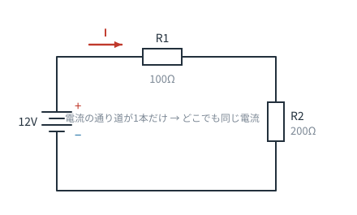
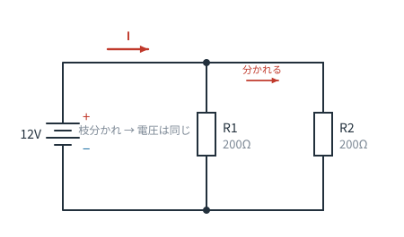
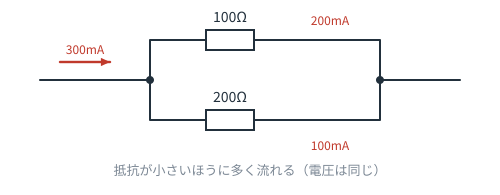
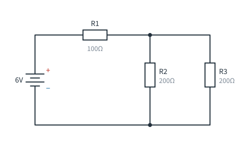
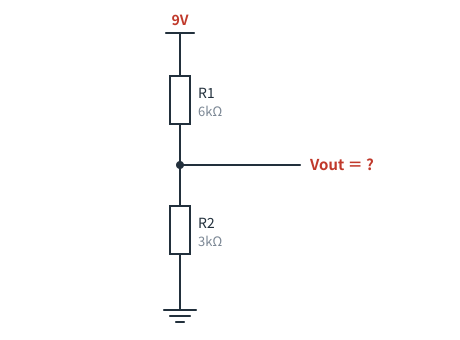

# 第3章　直列・並列・分圧

**この章のゴール**
- 直列と並列を見た目で見分けられる
- 「電流が同じ」「電圧が同じ」を使い分けられる
- 分圧回路を見た瞬間に意味がわかる

---

## 3-1. つなぎ方は2種類しかない

複雑に見える回路も、突き詰めると **直列** と **並列** の組み合わせです。

### 直列：一本道



部品が数珠つなぎで、電流の通り道が**1本しかない**状態です。

| 直列のルール | |
|---|---|
| 電流 | **どこでも同じ**（分かれる場所がないので当然） |
| 電圧 | 各部品に**分かれてかかる**。合計＝電源電圧 |
| 合成抵抗 | R = R1 + R2 + …（**足すだけ**） |

上の図なら、合成抵抗は `100 + 200 = 300Ω`。
電流は `12 ÷ 300 = 0.04A = 40mA`。
R1にかかる電圧は `0.04 × 100 = 4V`、R2は `0.04 × 200 = 8V`。合計12V。ちゃんと合いますね。

> **直感**：細い管を2本つなげたら、もっと流れにくくなる。当然です。

### 並列：枝分かれ



部品の両端が、それぞれ同じ場所につながっている状態です。

| 並列のルール | |
|---|---|
| 電圧 | **どれも同じ**（両端が同じノードだから） |
| 電流 | 枝に**分かれて流れる**。合計＝元の電流 |
| 合成抵抗 | 1/R = 1/R1 + 1/R2 + …（**元のどれよりも小さくなる**） |

上の図なら、`1/R = 1/200 + 1/200 = 2/200` → `R = 100Ω`。

> **直感**：管を2本に増やしたら、全体としては流れやすくなる。だから抵抗は減ります。
> 同じ値の抵抗2本の並列は、**必ず半分**。これは覚えておくと便利です。

---

## 3-2. 電流は「流れやすいほう」に多く流れる



並列では両端の電圧が同じなので、オームの法則から **抵抗が小さいほうに多く流れます**。

上の例なら、100Ω と 200Ω に電圧が同じだけかかるので、電流の比は **2 : 1**。
合計300mAなら、200mA と 100mA に分かれます。

> ⚠️ ここから重要な帰結：もし片方の抵抗が **0Ω（＝ただの電線）** だったら、電流は全部そちらに流れます。
> これが **ショート（短絡）** です。電源の＋と−が電線でつながると、抵抗ほぼゼロ → 巨大な電流 → 発熱・発火。
> 「ショートは危ない」の正体は、この式です。

---

## 3-3. 分圧回路：たぶん一番よく見る形

抵抗2本を直列にして、その**真ん中から電圧を取り出す**回路を **分圧回路（voltage divider）** といいます。


```
Vout ＝ Vin × R2 ÷ (R1 + R2)
```

図の例では、`12V × 1k / (2k + 1k) = 4V`。

### なぜこの形が大事なのか

回路図でこの形（**上から抵抗、抵抗、GND。真ん中から線が出ている**）を見たら、
考えることはただ1つ、**「電圧を減らして取り出したいんだな」**です。

使い道はこんなところです。

- 12V の信号を 3.3V のマイコンで読めるように下げる
- センサ（抵抗値が変わる部品）の変化を電圧の変化に変える（→ 第9章）
- トランジスタやオペアンプの動作点を決める

### 覚え方のコツ

`R2 / (R1 + R2)` を暗記するより、**「下の抵抗の取り分」**と覚えるほうが早いです。
抵抗が直列なら、電圧は**抵抗の比のとおりに分けられる**。それだけです。

- 上下が同じ値 → ちょうど半分
- 下が上の2倍 → 全体の 2/3
- 下が上の1/2 → 全体の 1/3

> ⚠️ 注意：分圧の出力から**大きな電流を取ると、電圧は下がります**。
> 分圧は「信号を作る」ためのもので、「電源を作る」ためのものではありません。
> モータやLEDを分圧で動かそうとすると、うまくいきません。

---

## 3-4. この章のまとめ

- 直列＝一本道。電流が同じ。抵抗は足し算
- 並列＝枝分かれ。電圧が同じ。抵抗は減る
- 電流は抵抗の小さいほうに多く流れる（極限がショート）
- 分圧＝抵抗の比で電圧を分ける。回路図の超頻出パターン

---

## 演習問題

**問1.** 次の回路について答えてください。



（a）R2 と R3 の合成抵抗は？
（b）回路全体の合成抵抗は？
（c）電池から流れ出る電流は？
（d）R2 に流れる電流は？

<details>
<summary>解答を見る</summary>

（a）R2 と R3 は並列。同じ値なので半分 → **100Ω**
（b）R1（直列100Ω）＋ 100Ω → **200Ω**
（c）`I = 6 ÷ 200 = 0.03A` → **30mA**
（d）R1 で `0.03 × 100 = 3V` 使うので、並列部にかかるのは `6 − 3 = 3V`。
　　R2 に流れるのは `3 ÷ 200 = 0.015A` → **15mA**（R3 にも同じく15mA。合計30mAで合致）

</details>

---

**問2.** 次の分圧回路の Vout は何Vですか。



<details>
<summary>解答を見る</summary>

```
Vout = 9V × 3kΩ / (6kΩ + 3kΩ) = 9 × 1/3 = 3V
```

**答え：3V**

（下の抵抗が全体の 1/3 なので、電圧も 1/3 と考えれば暗算できます）

</details>

---

**問3.** 5V を、ちょうど半分の 2.5V にしたい。同じ値の抵抗2本を使う分圧回路を考えました。
抵抗は 100Ω でも 10kΩ でも Vout は 2.5V になりますが、どちらを選ぶべきでしょう。理由も答えてください。

<details>
<summary>解答を見る</summary>

一般には **10kΩ** のほうが適切です。

100Ω の場合、抵抗自身に `5 ÷ 200 = 25mA` が常に流れ続けます。これは**何もしていないのに電力を捨てている**状態（電池なら消耗が早い）。
10kΩ なら `5 ÷ 20k = 0.25mA` で済みます。

ただし、大きくしすぎる（例：10MΩ）とノイズに弱くなったり、つないだ相手に電圧を引っ張られたりします。
実務では **1kΩ〜100kΩ** あたりが定番です。

</details>

---

**問4.** 電池の＋と−を、抵抗を入れずに電線で直接つなぐと何が起きますか。第3章の言葉で説明してください。

<details>
<summary>解答を見る</summary>

電線の抵抗はほぼ 0Ω なので、`I = V ÷ R` の R がほぼゼロ → **電流が極端に大きくなります**。
その結果、電線と電池が急激に発熱し、やけど・発火・電池の破裂につながります。これがショート（短絡）です。

</details>

---

⬅️ [第2章](ch02-schematic.md) ／ [目次](README.md) ／ ➡️ [第4章：電源とGND](ch04-power-gnd.md)
