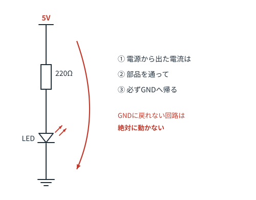
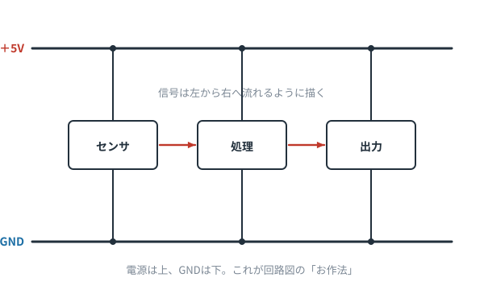
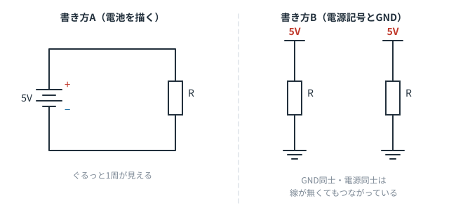

# 第4章　電源とGND — 回路図の骨格を掴む

**この章のゴール**
- GND が何なのか説明できる
- 回路図の「上下」と「左右」の意味がわかる
- 初めて見る回路図でも、骨組みだけ先に取り出せる

---

## 4-1. GND（グラウンド）とは「0Vと決めた場所」

GND は「アース」「接地」とも呼ばれますが、電子回路では**地面とは関係ありません**。

> **GND ＝ 電圧を測るときの基準点。ここを 0V と決めた場所。**

第0章で「電圧は差でしかない」と言いました。だから、どこかを「0V」と決めないと、電圧の話ができません。
そこで回路の中の1点を選んで「ここが0V」と宣言します。それが GND です。

- 「この端子は 5V」＝「GNDから見て 5V 高い」
- 電池なら、ふつう **−側を GND** にします
- GND は、電流が電源へ帰るための**共通の帰り道**でもあります

---

## 4-2. 電流は必ずGNDに帰る

回路が動かないとき、初心者がいちばん見落とすのがこれです。

**部品にプラスの電源をつないだだけでは、何も起きません。**
GND までつながって、はじめて電流の輪が閉じます。

センサモジュールやマイコンを使うときも同じで、
「電源（VCC）」「GND」「信号線」の3本のうち、**GNDのつなぎ忘れ**が不動の原因No.1です。

> 複数の基板や機器をつなぐときは、**GND同士を必ず共通に**してください（共通グラウンド）。
> 基準がずれていると、信号の電圧が何を意味しているのか分からなくなります。

---

## 4-3. 回路図には「お作法」がある

ほとんどの回路図は、この暗黙のルールで描かれています。

| 位置 | 意味 |
|---|---|
| **上** | 電源（＋5V、＋12V など） |
| **下** | GND（0V） |
| **左** | 入力（スイッチ、センサ、信号が入ってくる側） |
| **右** | 出力（LED、モータ、次の回路へ渡す側） |

つまり、**電気は上から下へ、信号は左から右へ**流れるように描かれています。

これを知っているだけで、初めて見る回路図でも「たぶんこの辺が入力で、この辺が出力だな」と当たりがつけられます。

> もちろん例外はあります。大きな回路図では収まりの都合で崩れます。でも「原則こう」と知っていることが大事です。

---

## 4-4. 電源記号のいろいろ

同じ「5Vにつながっている」ことを表すのに、いくつも書き方があります。

- 横棒に `+5V` と書いたもの
- 上向きの矢印に `VCC` / `VDD`
- 単に `5V` とラベルだけ

**VCC / VDD / V+ などは、どれも「プラスの電源」**だと思って構いません
（厳密にはトランジスタ回路由来の使い分けがありますが、読む分には気にしなくてOKです）。

GND も同様に `GND` `VSS` `0V`、記号も三角形だったり櫛形だったりします。同じものです。

---

## 4-5. 骨組みだけ先に取り出す読み方

大きな回路図を前にしたときの実践テクニックです。

1. **まず電源とGNDに蛍光ペンを引く**（頭の中でOK）
2. 残った部分を、電源からGNDへ落ちる**縦の道**ごとに区切る
3. 1本の道ずつ「これは何をしたい道か」を考える

回路図は、実は **「電源からGNDへ落ちる道の集まり」** です。
そう思って見ると、ごちゃごちゃした図が急に整理されて見えます。

---

## 4-6. この章のまとめ

- GND ＝ 0V と決めた基準点であり、電流の共通の帰り道
- GND につながっていない回路は動かない
- 回路図は「電源が上、GNDが下、信号は左から右」
- VCC / VDD は全部プラス電源、GND / VSS は全部0V
- 回路図は「電源からGNDへ落ちる道」の集まりとして読む

---

## 演習問題

**問1.** 友人が「センサの VCC を 5V につないで、信号線をマイコンにつないだのに動かない」と言っています。まず何を確認するよう伝えますか。

解答を見る

**GND がつながっているか。**
センサとマイコンの GND を共通につながないと、電流の帰り道がなく、また信号の電圧の基準も定まりません。

---

**問2.** 次の回路図で、GND記号が3か所に描かれています。この3点の電圧の関係はどうなっていますか。

解答を見る

**3点とも同じ電圧（0V）で、電気的に同じ1つのノードです。**
線が描かれていないだけで、実際にはすべてつながっています。

---

**問3.** 「A点の電圧は 3.3V です」。この文が意味を持つために、暗黙に決まっている必要があるものは何ですか。

解答を見る

**GND（0Vの基準点）がどこか**が決まっていること。
基準がなければ「3.3V高い」も何も言えません。

---

**問4.** ある回路図で、右端に LED、左端にスイッチが描かれていました。この回路は、大まかに何をするものだと推測できますか。

解答を見る

回路図のお作法（左＝入力、右＝出力）から、
**スイッチという入力によって、LEDという出力を制御する回路**だと推測できます。

間にトランジスタやICがあれば「入力を加工して出力する」もう少し複雑な回路ですが、
**入力と出力の見当をつけてから中身を読む**、という順番が大事です。

---

⬅️ [第3章](ch03-series-parallel.md) ／ [目次](README.md) ／ ➡️ [第5章：コンデンサ](ch05-capacitor.md)
