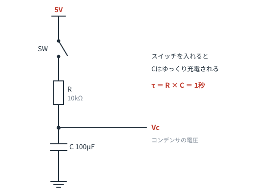
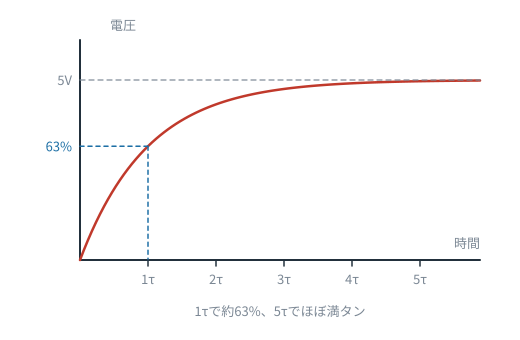
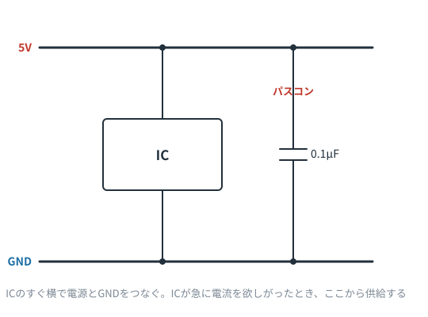
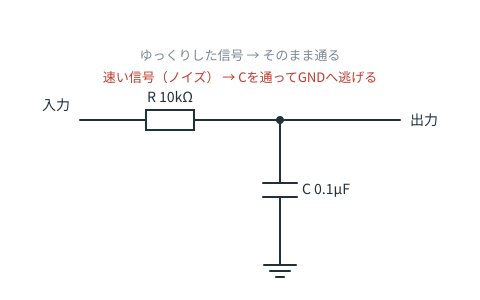
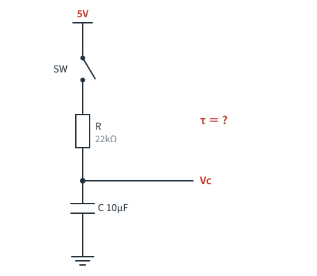

# 第5章　コンデンサ — ためる・逃がす・時間を作る

**この章のゴール**
- コンデンサが何をする部品かイメージできる
- 回路図でコンデンサを見たとき、3つの役割のどれかを判別できる
- 時定数 τ = R × C の意味がわかる

---

## 5-1. コンデンサ＝小さなバケツ

水流モデルで言うと、コンデンサは **パイプの途中に置かれた、ゴム膜で仕切られたタンク**です。

- 水が流れ込むと、膜がふくらんで**水をためる**
- 満タンになると、それ以上は流れなくなる
- 逆向きに押せば、ためた水を吐き出す

電気でも同じで、コンデンサは**電荷をためる**部品です。容量の単位は **F（ファラド）**。
実際に使うのは µF（マイクロ）や nF、pF です。

ここから、コンデンサの性格が導けます。

> **直流（変化しない電圧）は通さない。交流（変化する電圧）は通す。**

満タンになれば止まる＝直流は通さない。
押したり引いたりを繰り返せば膜が動き続ける＝交流は通る。この直感が全部の基礎です。

---

## 5-2. 役割① 電気をためる（充放電と時定数）



スイッチを入れると、抵抗Rを通ってコンデンサCが充電されます。
このとき、Cの電圧は**じわっと**上がります。一瞬では上がりません。



この「じわっと」の速さを決めるのが **時定数（じていすう）τ** です。

```
τ ＝ R × C
```

- τ 秒後 … 目標電圧の約 **63%** まで充電
- 5τ 秒後 … ほぼ満タン（99%以上）

上の図なら `10kΩ × 100µF = 10,000 × 0.0001 = 1秒`。5秒でほぼ満タンです。

> **計算のコツ**：kΩ と µF を掛けると、答えは**ミリ秒**になります。
> `10kΩ × 100µF` → `10 × 100 = 1000ms = 1秒`。単位換算のミスが激減します。

この性質は、「一定時間待つ」「ゆっくり立ち上げる」「スイッチのチャタリング（接点のバタつき）をならす」といった用途に使われます。

---

## 5-3. 役割② 電源を安定させる（パスコン）

回路図でICのすぐそばに描かれている、**0.1µF くらいの小さなコンデンサ**。これがいちばん出会う機会が多いコンデンサです。



**パスコン（バイパスコンデンサ／デカップリングコンデンサ）** と呼ばれます。

なぜ必要か。ICは動作するとき、**一瞬だけ大きな電流を必要とする**ことがあります。
電源からICまでは配線が長く、そのわずかな抵抗とインダクタンスのせいで、電流が瞬時には届きません。すると電源電圧が一瞬落ち込み、ICが誤動作します。

そこで、**ICの真横に小さな電気のタンクを置いておく**。これがパスコンです。

> 回路図で「ICの電源ピンとGNDの間に 0.1µF」を見かけたら、**深く考えなくてOK**です。
> 「お守り」として必ず入れるもの、と覚えてください。実際、ほぼすべての実用回路に入っています。

---

## 5-4. 役割③ 信号を選り分ける（フィルタ）



抵抗とコンデンサを組み合わせると、**周波数によって通す／通さないを変える**回路になります。

上の図は **ローパスフィルタ**（低い周波数を通す）。

- ゆっくりした信号 → Cは充電しきってしまうので、素通りして出力へ
- 速い信号（ノイズ） → Cを通ってGNDへ逃げてしまい、出力に出てこない

**「信号線から、コンデンサがGNDへ降りている」形を見たら、ノイズ取りだな**と思ってください。

RとCを入れ替えれば、逆に高い周波数だけを通す**ハイパスフィルタ**になります。

---

## 5-5. 種類と極性（実物の注意）

| 種類 | 容量の目安 | 極性 | 主な用途 |
|---|---|---|---|
| セラミックコンデンサ | pF 〜 1µF | なし | パスコン、フィルタ |
| 電解コンデンサ | 1µF 〜 数千µF | **あり** | 電源の平滑、大容量のため込み |
| フィルムコンデンサ | nF 〜 µF | なし | オーディオ、精度が要るところ |

⚠️ **電解コンデンサには極性があります。** 逆に挿すと発熱・破裂します。
実物は「−」側の足が短く、本体に帯（−マーク）が印刷されています。
回路図では、**片側が曲線になっている記号**か、「＋」の表示で見分けます。

---

## 5-6. この章のまとめ

- コンデンサ＝電気のバケツ。直流は通さず、交流は通す
- τ = R × C。τ で63%、5τ でほぼ満タン
- ICの横の 0.1µF はパスコン（電源のお守り）
- 信号線からGNDに降りるコンデンサはノイズ取り
- 電解コンデンサは極性に注意

---

## 演習問題

**問1.** 次の回路の時定数 τ は何秒ですか。また、Vc が 5V のほぼ満タンになるまで何秒かかりますか。



<details>
<summary>解答を見る</summary>

```
τ = 22kΩ × 10µF = 22 × 10 = 220ms = 0.22秒
```
ほぼ満タンは 5τ なので `0.22 × 5 = 1.1秒`。

**答え：τ = 0.22秒、満タンまで約1.1秒**

</details>

---

**問2.** ある回路図で、IC の電源ピンとGNDの間に 0.1µF のセラミックコンデンサが入っていました。これは何のためですか。

<details>
<summary>解答を見る</summary>

**パスコン（バイパスコンデンサ）**。
ICが瞬間的に必要とする電流をすぐ横から供給し、電源電圧の落ち込みとノイズを抑えるためです。

</details>

---

**問3.** τ を今の10倍にしたい。抵抗と容量、どちらをどう変えればいいですか（2通り答えてください）。

<details>
<summary>解答を見る</summary>

τ = R × C なので、
- **Rを10倍にする**（例：10kΩ → 100kΩ）
- **Cを10倍にする**（例：10µF → 100µF）

どちらでもOKです。ただし実際は、Rを大きくしすぎるとノイズに弱くなり、Cを大きくすると部品が大きく高価になる、というトレードオフがあります。

</details>

---

**問4.** 「コンデンサは直流を通さない」のに、電源ラインとGNDの間に入れるパスコンは意味があるのはなぜですか。

<details>
<summary>解答を見る</summary>

パスコンが相手にしているのは**直流ではなく、電源電圧の急な変動（＝交流成分）**だからです。

安定しているときは電流を通さず（＝無駄な消費がない）、電圧が急に落ち込んだ瞬間だけ、ためた電荷を放出して支えます。
「直流は通さず、変化だけに反応する」という性質を、まさに利用しているわけです。

</details>

---

⬅️ [第4章](ch04-power-gnd.md) ／ [目次](README.md) ／ ➡️ [第6章：コイルと逆起電力](ch06-coil.md)
