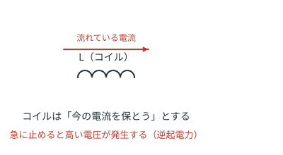
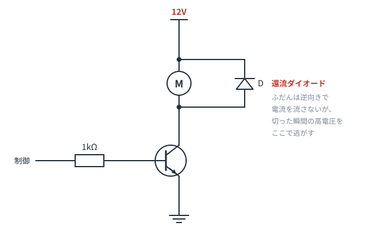

# 第6章　コイルと逆起電力

**この章のゴール**
- コイルの性格を一言で言える
- モータ・リレーを扱うときに必要な「還流ダイオード」の意味がわかる

> この章は、初心者のうちは**深追い不要**です。
> ただし「モータやリレーを動かしたい」なら、6-3 だけは絶対に読んでください。壊さないためです。

---

## 6-1. コイル＝電流の慣性

コイルは、導線をぐるぐる巻いただけの部品です（インダクタとも呼びます）。単位は **H（ヘンリー）**。

性格を一言で言うと、

> **コイルは、今流れている電流を、そのまま保とうとする。**

これは「動いているものは動き続けたい」という**慣性**とまったく同じイメージです。
水流モデルなら、**重い水車**だと思ってください。回り出すのに時間がかかり、止めようとしても止まらない。

ここからコンデンサとちょうど**正反対**の性質が出てきます。

| | コンデンサ | コイル |
|---|---|---|
| ためるもの | 電荷（電圧） | 磁気（電流） |
| 急に変えられないもの | **電圧** | **電流** |
| 直流に対して | 通さない | そのまま通す（ただの電線） |
| 高い周波数に対して | 通しやすい | 通しにくい |

---

## 6-2. 逆起電力：コイルは切られると怒る

コイルに流れている電流を、スイッチで**急に切る**とどうなるか。

コイルは「電流を保とう」とします。でも道が切られたので、流せません。
そこでコイルは、**なんとか流し続けようとして、自分で高い電圧を発生させます**。これが **逆起電力** です。

どれくらい高いか。数十Vから、条件によっては数百Vに達します。12Vの回路でも、です。

これが、スイッチの接点を焦がしたり、トランジスタを一瞬で壊したりする犯人です。

> 車のイグニッションコイルは、この現象をわざと利用して、12V から火花を飛ばす数万Vを作っています。
> つまり逆起電力は、それくらい強力な現象です。

---

## 6-3. 還流ダイオード（絶対に覚える1パターン）

モータ、リレー、ソレノイド——**中に巻き線が入っているもの＝コイル**です。
これらをトランジスタでON/OFFする回路には、必ずこの部品が入っています。

**モータと並列に、逆向きにダイオードを1本入れる。** これだけです。

- ふだん（モータが回っている間）：ダイオードは逆向きなので、電流を流さない。存在しないのと同じ
- スイッチを切った瞬間：コイルが発生させた逆向きの高電圧に対して、ダイオードは**順方向**になる
- → 電流はダイオードを通ってコイルの中をぐるぐる回り、**安全に消えていく**

この「逃がし道」を作ってやることで、トランジスタに高電圧がかからずに済みます。

**還流ダイオード**、**フライバックダイオード**、**フリーホイールダイオード** ——呼び名はいろいろですが全部同じものです。

> 回路図で「モータやリレーのコイルに、逆向きのダイオードが並列に入っている」形を見たら、
> **「あ、逆起電力対策だな」**と読めればこの章は卒業です。

---

## 6-4. コイルの他の使い道（参考）

- **電源回路（DC-DCコンバータ）**：電流を保とうとする性質を使って、電圧を上げ下げする
- **ノイズフィルタ**：高い周波数を通しにくい性質で、電源ラインのノイズを止める（フェライトビーズなど）
- **トランス**：2つのコイルを磁気で結合して、電圧を変換する

いずれも「電流の慣性」から説明できます。今は名前だけ知っていれば十分です。

---

## 6-5. この章のまとめ

- コイルは電流を保とうとする（電流の慣性）
- 急に電流を止めると、高い逆起電力が出る
- モータ・リレーには**還流ダイオードを逆向きに並列**。これが定番パターン
- コンデンサとコイルは、ちょうど正反対の性格

---

## 演習問題

**問1.** 次の回路で、Dは何のために入っていますか。また、モータが回っている間、Dには電流が流れますか。

解答を見る

**逆起電力からトランジスタを守るため（還流ダイオード）。**

モータが回っている間、Dは電源電圧に対して逆向きなので、**電流は流れません**。
トランジスタをOFFにした瞬間だけ、コイルが作る逆向きの電圧によって順方向になり、電流の逃げ道になります。

---

**問2.** 還流ダイオードを付けずにリレーをトランジスタで駆動しました。しばらくは動きましたが、やがてトランジスタが壊れました。何が起きたと考えられますか。

解答を見る

リレーのコイルを OFF にするたびに逆起電力（数十〜数百V）が発生し、
その電圧がトランジスタのコレクタ‐エミッタ間にかかり続けたため、耐圧を超えて破壊されたと考えられます。

「最初は動くのに、だんだん壊れる」のはこのパターンの典型です。

---

**問3.** コンデンサとコイルの性質を、それぞれ「急に変えられないもの」という観点で対比して説明してください。

解答を見る

- **コンデンサ**：電圧を急に変えられない。だから電圧を安定させる用途（パスコン）に使う
- **コイル**：電流を急に変えられない。だから電流を安定させる用途（フィルタ、DC-DC）に使う

そして「急に変えようとすると暴れる」のも共通です。
コンデンサは電源投入時に大きな突入電流が流れ、コイルは遮断時に大きな電圧が出ます。

---

⬅️ [第5章](ch05-capacitor.md) ／ [目次](README.md) ／ ➡️ [第7章：ダイオードとLED](ch07-diode.md)
