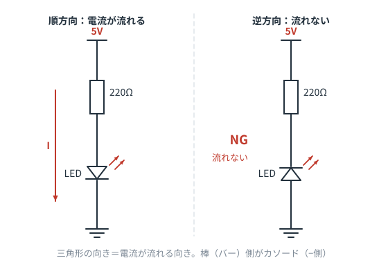
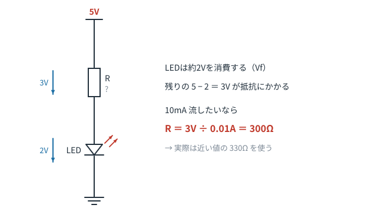
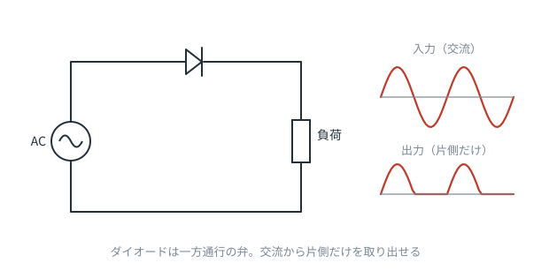
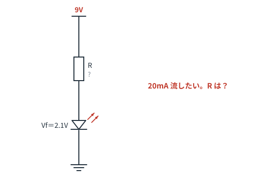

# 第7章　ダイオードとLED

**この章のゴール**
- ダイオードの向きを回路図から読み取れる
- LEDに抵抗が必要な理由を説明できる
- LEDの抵抗値を自分で計算できる

---

## 7-1. ダイオード＝一方通行の弁

ダイオードは、**電流を一方向にしか流さない**部品です。水道の逆止弁とまったく同じ役割です。



記号の読み方は簡単です。

> **三角形が指している向きが、電流が流れる向き。棒（バー）でせき止められている側からは流れない。**

- 三角形側の足を **アノード（A、＋側）**
- 棒側の足を **カソード（K、−側）**

実物のダイオードやLEDにも、カソード側に**帯（ライン）**が印刷されています。記号の棒と対応しているので覚えやすいです。
（LEDの場合は、足の**短いほう**がカソード、本体の**平らに欠けている側**がカソードです）

---

## 7-2. 順方向電圧（Vf）：ダイオードは電圧を「食う」

ダイオードは、順方向でも**ある程度の電圧をかけないと流れ始めません**。
そして流れ始めると、そこでかかる電圧はほぼ一定になります。これを **順方向電圧 Vf** といいます。

| 部品 | Vf の目安 |
|---|---|
| シリコンダイオード（1N4148、1N4007など） | 約 **0.6〜0.7V** |
| ショットキーバリアダイオード | 約 0.3V |
| 赤色LED | 約 1.8〜2.0V |
| 青・白色LED | 約 3.0〜3.4V |

「ダイオードを通ると 0.7V 減る」「赤色LEDを通ると 2V 減る」——この感覚が大事です。

---

## 7-3. LEDには、なぜ抵抗が必要なのか

ここが第7章のいちばん大事なところです。

LEDは抵抗器と違って、**電圧が少し上がるだけで、電流が爆発的に増える**性質があります。
Vf を超えた瞬間、電流を制限するものが何もないと、**あっという間に定格を超えて焼き切れます**。

だから、**電流を決めてやる係**が必要です。それが直列に入れる抵抗（電流制限抵抗）です。



### 抵抗値の求め方

```
R ＝ (電源電圧 − Vf) ÷ 流したい電流
```

考え方は「**電源電圧のうち、LEDが食べ残した分が抵抗にかかる**」だけです。

例：5V電源、赤色LED（Vf ≒ 2V）、10mA 流したい場合

```
抵抗にかかる電圧 = 5 − 2 = 3V
R = 3V ÷ 0.01A = 300Ω
```

市販の抵抗に 300Ω はあまりないので、近い **330Ω** を選びます。
（抵抗を大きめにすると電流は少なめ＝やや暗いが安全。迷ったら大きめが正解です）

> 一般的なLEDの定格電流は **20mA** 前後ですが、最近のLEDは明るいので **5〜10mA でも十分**なことが多いです。

### 消費電力も一応チェック

`P = 3V × 0.01A = 0.03W`。1/4W抵抗で余裕です。

---

## 7-4. ダイオードの代表的な使い道

### ① 整流（交流を直流に変える）



交流はプラスとマイナスが交互に入れ替わる電気です。ダイオードで片側だけを取り出せば、
向きの揃った電気になります。これが **整流** で、ACアダプタの中身の第一段階です。

（さらにコンデンサで平滑すると、なめらかな直流に近づきます。第5章の「ためる」働きです）

### ② 逆接続保護

電池を逆向きに入れてしまっても回路が壊れないよう、電源の入口に1本入れておく使い方です。
正しい向きなら電流が通り、逆向きなら通しません。

### ③ 還流ダイオード

第6章でやったモータ・リレーの保護です。

---

## 7-5. この章のまとめ

- ダイオードは一方通行。三角形の向きが電流の向き、棒側がカソード
- 順方向でも Vf 分の電圧を食う（シリコン0.7V、LED 2〜3V）
- LEDは電流制限抵抗が必須。`R =（電源電圧 − Vf）÷ 流したい電流`
- 用途は整流・逆接続保護・還流ダイオード

---

## 演習問題

**問1.** 次の回路で、LEDに 20mA 流したい。R は何Ωにすればよいですか。また、実際に選ぶ抵抗値は？



<details>
<summary>解答を見る</summary>

```
抵抗にかかる電圧 = 9 − 2.1 = 6.9V
R = 6.9 ÷ 0.02 = 345Ω
```

計算値は **345Ω**。市販品には無いので、近い **330Ω** か **360Ω** を選びます。

- 330Ω にすると `6.9 ÷ 330 ≈ 21mA`（少し多め）
- 360Ω にすると `6.9 ÷ 360 ≈ 19mA`（少し少なめ＝安全側）

念のため電力も確認：`P = 6.9 × 0.02 ≈ 0.14W` → 1/4W抵抗でOK。

</details>

---

**問2.** 5V電源で、青色LED（Vf = 3.2V）を 10mA で光らせたい。抵抗値は？

<details>
<summary>解答を見る</summary>

```
R = (5 − 3.2) ÷ 0.01 = 180Ω
```

**答え：180Ω**（ちょうど市販の標準値にあります）

なお、3.3V電源だと `(3.3 − 3.2) ÷ 0.01 = 10Ω` となり、余裕がほとんどありません。
青・白色LEDは Vf が高いので、**3.3V回路では点灯しにくい**ことがあります。これは実際によくハマるポイントです。

</details>

---

**問3.** LEDを抵抗なしで 5V 電源に直接つないだら、一瞬光って消えました。何が起きましたか。

<details>
<summary>解答を見る</summary>

電流を制限するものが何もないため、LEDのVf（約2V）を超えた瞬間に**過大な電流**が流れ、
LEDの半導体が発熱して焼損しました。

LEDは「電圧をかける部品」ではなく「**電流を流して使う部品**」だと考えると、抵抗が必要な理由が納得できます。

</details>

---

**問4.** 次の記号で、電流はどちら向きに流れますか。また、この足のうちカソードはどちらですか。


<details>
<summary>解答を見る</summary>

**三角形の先端が向いている方向（左の図では上から下）に流れます。**
**棒（バー）が描かれている側の足がカソード**（この図では下側、GND側）です。

右の図はダイオードが逆向きなので、電流は流れず、LEDは光りません。

</details>

---

⬅️ [第6章](ch06-coil.md) ／ [目次](README.md) ／ ➡️ [第8章：トランジスタとMOSFET](ch08-transistor.md)
