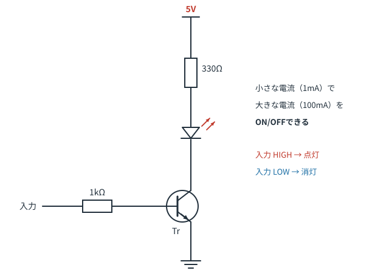
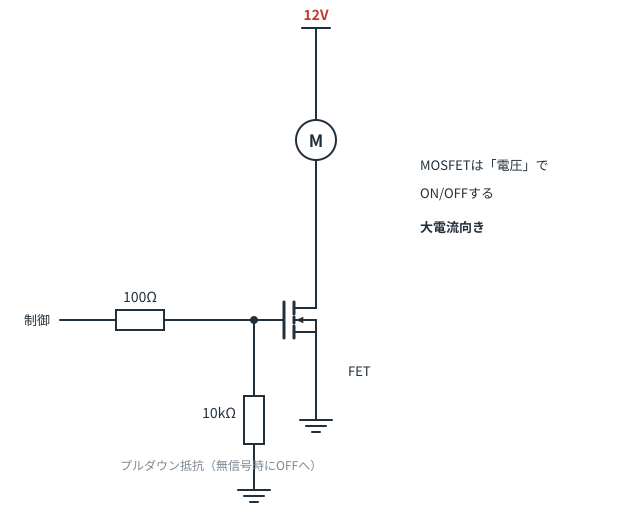
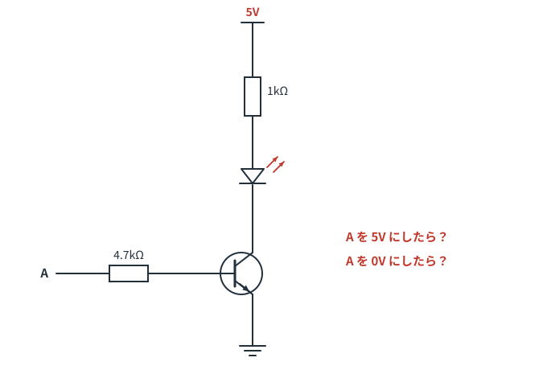

# 第8章　トランジスタとMOSFET

**この章のゴール**
- トランジスタを「電気で動くスイッチ」として理解する
- 回路図でトランジスタを見たとき、3本の足の役割がわかる
- ベース抵抗の意味がわかる

---

## 8-1. なぜトランジスタが必要なのか

マイコン（Arduinoなど）の出力ピンから取り出せる電流は、せいぜい **20mA程度**です。
一方、モータやたくさんのLEDは **数百mA〜数A** を必要とします。

そのまま直結すると、マイコンが壊れます。
そこで、**小さな信号で、大きな電流をON/OFFする係**が必要になります。これがトランジスタです。

> 水流モデルなら **蛇口のハンドル**です。
> 指で軽くひねるだけ（小さな力）で、太い管の水（大きな流れ）を止めたり流したりできる。

---

## 8-2. NPNトランジスタの3本足



足の名前と役割はこうです。

| 足 | 名前 | 役割 | 記号の見た目 |
|---|---|---|---|
| B | ベース（Base） | **制御する側**。ここに小さな電流を流す | 横から入る線（太い縦棒につながる） |
| C | コレクタ（Collector） | 大きな電流の**入口** | 上に出る足 |
| E | エミッタ（Emitter） | 大きな電流の**出口** | **矢印が付いている**足 |

**エミッタの矢印が外向き（外に出ていく）なら NPN型**です。
NPN の場合、エミッタは GND につなぎ、コレクタ側に動かしたいもの（負荷）をつなぎます。

### 動作はこれだけ

- ベースに電流を流す（HIGHにする） → **コレクタ‐エミッタ間がつながる（ON）**
- ベースに電流を流さない（LOWにする） → **切れる（OFF）**

つまり、**ベースの電流で操作される、機械式ではないスイッチ**です。

---

## 8-3. ベース抵抗の役目

トランジスタのベースには、必ず抵抗が直列に入っています。これは飾りではありません。

**ベース‐エミッタ間は、実はダイオードと同じ構造**です（第7章を思い出してください）。
つまり、約 **0.7V** を超えると、電流を制限するものがない限り、無制限に流れてしまいます。

LEDと同じ理屈です。だから電流制限抵抗が要ります。

### 計算のしかた（参考）

ベースに流す電流は、こう決めます。

```
ベース電流 Ib = (制御電圧 − 0.7V) ÷ ベース抵抗
```

例：5Vのマイコン出力、ベース抵抗 1kΩ の場合
```
Ib = (5 − 0.7) ÷ 1000 = 0.0043A = 4.3mA
```

トランジスタは、ベース電流の **hFE 倍（電流増幅率、数十〜数百倍）** までコレクタ電流を流せます。
hFE = 100 なら、4.3mA × 100 = 430mA まで扱える計算です。

> **実務のコツ**：スイッチとして使うときは、**しっかりONにする（飽和させる）**のが目的なので、
> 必要なコレクタ電流の **1/10 程度**のベース電流を流すのが定番です。
> 200mA 流したいなら 20mA 程度。細かい計算より、この目安で十分実用になります。

---

## 8-4. MOSFET：電圧で動くスイッチ



MOSFET（モスフェット）も同じくスイッチですが、性格が少し違います。

| | バイポーラトランジスタ | MOSFET |
|---|---|---|
| 足の名前 | ベース／コレクタ／エミッタ | **ゲート／ドレイン／ソース** |
| 制御するもの | **電流**（Ib） | **電圧**（Vgs） |
| 制御に必要な電流 | 数mA必要 | ほぼゼロ |
| 大電流のとき | 発熱しやすい | 発熱が少ない |
| 得意分野 | 小信号、安価 | **大電流のON/OFF** |

**ゲートに電圧をかけるだけ**でONになるので、マイコンからの制御にとても向いています。
モータやLEDテープなど、大きな電流を扱うなら、今はMOSFET（Nチャネル）が第一選択です。

> ⚠️ **ロジックレベル対応品を選ぶこと。**
> MOSFETには「ゲートに何V以上かけるとONになるか」の閾値があり、10V必要な品種もあります。
> 5V や 3.3V のマイコンで使うなら、データシートで「Logic Level」と書かれたものを選んでください。

### プルダウン抵抗

図でゲートとGNDの間に入っている 10kΩ は **プルダウン抵抗**です。
マイコンが起動する前など、ゲートが**どこにもつながっていない状態（宙ぶらりん）**だと、
静電気などでMOSFETが勝手にONになる可能性があります。それを防ぐため、確実にOFF側へ引っ張っておくものです。

（プルアップ／プルダウンは次章でしっかりやります）

---

## 8-5. 回路図でこう見えたら、こう読む

これがこの章の実用的な結論です。

> **「上に負荷（LED・モータ）、下にトランジスタ、ベースに抵抗を通って制御信号」**
> → **「マイコンで負荷をON/OFFしたいんだな」**

この形（**ローサイドスイッチ**といいます）は、電子工作の回路図で最頻出のパターンのひとつです。
細かい定数を読まなくても、形だけで意図がわかるようになれば十分です。

---

## 8-6. この章のまとめ

- トランジスタ＝小さな信号で大電流をON/OFFするスイッチ
- NPN：エミッタの矢印が外向き。エミッタをGNDへ、コレクタに負荷
- ベース抵抗は電流制限（ベースはダイオードだから）
- MOSFETは電圧で制御、大電流向き。ロジックレベル品を選ぶ
- 「負荷 → トランジスタ → GND」の縦の並びを見たら、負荷のON/OFF回路

---

## 演習問題

**問1.** 次の回路で、A の電圧を 5V にしたときと、0V にしたとき、LEDはどうなりますか。



<details>
<summary>解答を見る</summary>

- **A = 5V のとき**：ベース電流が流れる → トランジスタON → **LEDが点灯**
- **A = 0V のとき**：ベース電流が流れない → トランジスタOFF → **LEDは消灯**

参考までに電流も出しておきます。
ベース電流：`(5 − 0.7) ÷ 4.7kΩ ≈ 0.9mA`
コレクタ電流：`(5 − 2.0 − 0.2) ÷ 1kΩ ≈ 2.8mA`（LEDのVfを2.0V、ONしたトランジスタの電圧降下を0.2Vとして）

必要な増幅率は 2.8 ÷ 0.9 ≈ 3 倍。一般的なトランジスタ（hFE = 100以上）なら余裕でONになります。

</details>

---

**問2.** ベース抵抗を入れ忘れて、マイコンの出力ピンをトランジスタのベースに直結しました。何が起きますか。

<details>
<summary>解答を見る</summary>

ベース‐エミッタ間はダイオードと同じなので、0.7Vを超えた時点で**電流を制限するものが無くなり**、
過大な電流が流れます。結果として、**マイコンの出力ピンかトランジスタ（あるいは両方）が壊れます**。

LEDに抵抗が必要なのとまったく同じ理屈です。

</details>

---

**問3.** 3.3Vのマイコンで、12V・2A のモータをON/OFFしたい。バイポーラトランジスタとMOSFET、どちらを選びますか。理由も答えてください。

<details>
<summary>解答を見る</summary>

**MOSFET（Nチャネル、ロジックレベル品）** を選びます。

理由：
- 2A という大電流では、バイポーラトランジスタは飽和電圧による発熱が大きい
- バイポーラだと必要なベース電流も大きく（目安 200mA）、マイコンでは供給できない
- MOSFETはゲート電圧だけで制御でき、ON抵抗が小さいので発熱が少ない

さらに、モータなので **還流ダイオード（第6章）** を忘れずに入れます。

</details>

---

**問4.** MOSFETのゲートに、10kΩのプルダウン抵抗が入っている理由は？

<details>
<summary>解答を見る</summary>

マイコンのリセット中や未接続時に、ゲートが**電気的に宙ぶらりん（フローティング）**になると、
ノイズや静電気で電圧が中途半端に上がり、**意図せずONになる**ことがあるためです。

プルダウン抵抗で確実に0V側へ引っ張っておくことで、「何も指示がないときは必ずOFF」を保証します。
モータのような危険な負荷では特に重要です。

</details>

---

⬅️ [第7章](ch07-diode.md) ／ [目次](README.md) ／ ➡️ [第9章：定番回路パターン集](ch09-patterns.md)
