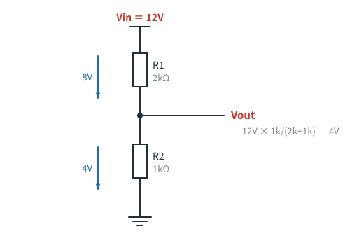
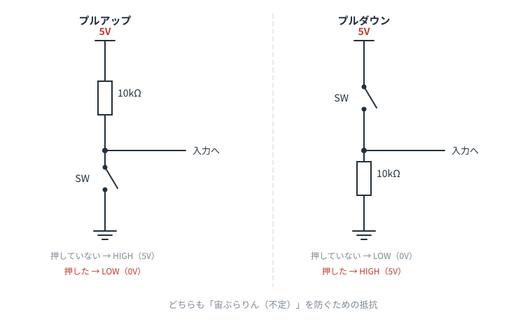
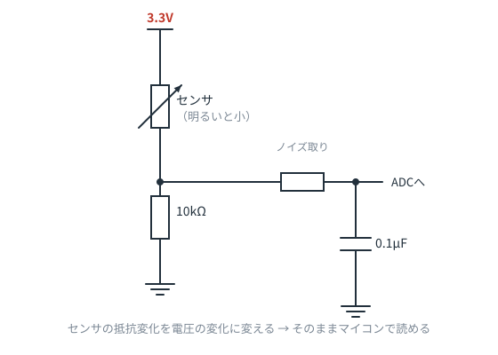

# 第9章　定番回路パターン集

**この章のゴール**
- よく出る「形」を7つ覚えて、見た瞬間に意味がわかるようにする

回路図が読める人は、実は**毎回ゼロから解析していません**。
知っているパターンに当てはめて、一瞬で「これはアレだな」と判断しています。

この章が、この教材の**山場**です。

---

## パターン① 電流制限抵抗（LEDの直列抵抗）

**見た目**：電源 → 抵抗 → LED → GND の縦一列
**意味**：LEDに流す電流を決めている
**チェックすること**：抵抗値から `(電源 − Vf) ÷ R` で電流を暗算。5〜20mAなら妥当

---

## パターン② 分圧（電圧を減らして取り出す）

**見た目**：抵抗2本が縦に並び、**真ん中から線が横に出ている**
**意味**：電源電圧を、抵抗の比で分けて取り出したい
**チェックすること**：下の抵抗の取り分が出力電圧

> 真ん中から出た線がどこへ行くかで、目的がわかります。
> マイコンのADCへ → 電圧測定。トランジスタのベースへ → 動作点の設定。

---

## パターン③ プルアップ／プルダウン

**見た目**：電源（またはGND）から抵抗を通ってきた線に、スイッチと入力線がつながっている
**意味**：**「宙ぶらりん（不定）」を防ぐ**

これは初心者が必ず引っかかるポイントなので、丁寧に説明します。

マイコンの入力ピンは、何もつながっていないと **HIGHでもLOWでもない不定状態** になり、ノイズを拾ってフラフラします。
そこで抵抗で「デフォルトの状態」を作っておきます。

| | 押していないとき | 押したとき |
|---|---|---|
| **プルアップ**（抵抗が電源側、スイッチがGND側） | HIGH（5V） | LOW（0V） |
| **プルダウン**（抵抗がGND側、スイッチが電源側） | LOW（0V） | HIGH（5V） |

**抵抗値は 10kΩ が定番**です（大きすぎるとノイズに弱く、小さすぎると押したときに無駄な電流が流れます）。

> ⚠️ プルアップの場合、**ボタンを押すと LOW になる**（論理が逆転する）点に注意。
> 「押したら0V」は直感に反しますが、実務ではプルアップのほうが多く使われます。

---

## パターン④ センサの分圧読み取り

**見た目**：分圧回路の片方が、可変抵抗の記号（斜め矢印付き）やセンサ
**意味**：**抵抗の変化を、電圧の変化に変換している**

マイコンは「抵抗値」を直接測れません。測れるのは電圧だけです。
だから、明るさで抵抗が変わるCdSセル、温度で変わるサーミスタ、力で変わる感圧センサなどは、
**必ず分圧回路にして**から読み取ります。

図の右側にある「抵抗＋コンデンサ」は、パターン⑥（フィルタ）です。ノイズを落として安定して読むためです。

---

## パターン⑤ ローサイドスイッチ（トランジスタで負荷をON/OFF）

**見た目**：電源 → 負荷（LED・モータ） → トランジスタ → GND、ベースに抵抗を通って制御信号
**意味**：小さな信号で、大きな電流をON/OFFしたい

負荷の**下側（GND側）**にスイッチがあるので「ローサイド」と呼びます。回路が簡単なので圧倒的に多く使われます。

**セットで覚えること**：
- ベースには必ず抵抗（数百Ω〜10kΩ）
- 負荷がモータやリレーなら、**還流ダイオード**（パターン⑦）

---

## パターン⑥ RCフィルタ（ノイズ取り）

**見た目**：信号線に直列の抵抗＋**信号線からGNDへ降りるコンデンサ**
**意味**：速い変化（ノイズ）をGNDへ逃がして、信号をなめらかにする

**「信号線からGNDにコンデンサが降りていたら、それはノイズ対策」**。これだけ覚えておけば、初見の回路図で迷いません。

---

## パターン⑦ 還流ダイオード

**見た目**：モータ・リレーのコイルと**並列に、逆向きのダイオード**
**意味**：OFFにした瞬間の逆起電力を逃がして、トランジスタを守る

「なぜ逆向き？」と思ったら、第6章に戻ってください。ふだんは通さず、**危険な瞬間だけ道になる**からです。

---

## おまけ：パスコン

**見た目**：ICの電源ピンとGNDの間に 0.1µF
**意味**：電源の安定化（お守り）
**読み方**：**深く考えなくてよい**。むしろ「無かったら怪しい」と思うくらいでOK

---

## 9-1. パターン早見表

| 見た目 | 意味 |
|---|---|
| 抵抗が LED と直列 | 電流制限 |
| 抵抗2本が縦に並び、中間から線が出ている | 分圧 |
| 電源 → 抵抗 → スイッチ → GND、中間から入力へ | プルアップ |
| 分圧の片方がセンサ | 抵抗変化を電圧に変換 |
| 負荷 → トランジスタ → GND | 負荷のON/OFF |
| 信号線からGNDへ降りるコンデンサ | ノイズ取り |
| コイルと並列の逆向きダイオード | 逆起電力対策 |
| IC の電源ピン横の 0.1µF | パスコン |

このリストを手元に置いて回路図を読むと、**見える景色が変わります**。

---

## 演習問題

**問1.** プルアップ抵抗を使ったスイッチ回路で、ボタンを押したときマイコンが読む値は HIGH と LOW のどちらですか。

解答を見る

**LOW（0V）**。

押していないときは抵抗を通して電源につながっているので HIGH、
押すとスイッチがGNDに直結するので LOW になります。

（プルアップ抵抗の10kΩより、スイッチの導通抵抗のほうが圧倒的に小さいため、GNDが勝ちます）

---

**問2.** 明るさセンサ（CdSセル：明るいほど抵抗が小さい）を、上側に配置した分圧回路で読み取ります。
明るくなったとき、出力電圧は上がりますか、下がりますか。

解答を見る

**上がります。**

明るい → 上側センサの抵抗が小さくなる → 下側の抵抗の取り分（比率）が大きくなる → 出力電圧が上がる。

> 逆に、センサを下側に配置すると論理が反転します。
> どちらでも動きますが、「どちらが上か」でプログラム側の判定が変わるので、回路図をよく見る必要があります。

---

**問3.** ある回路図で、信号線に 1kΩ が直列に入り、その後ろから 0.1µF がGNDに降りていました。これは何のパターンですか。

解答を見る

**RCローパスフィルタ（ノイズ取り）**。

時定数は `1kΩ × 0.1µF = 0.0001秒 = 0.1ms` なので、それより速い変化（高周波ノイズ）を落とします。

---

**問4.** マイコンでリレーを駆動する回路を設計します。必要な「定番パターン」を3つあげてください。

解答を見る

1. **ローサイドスイッチ**（トランジスタ or MOSFETでリレーコイルをON/OFF）
2. **ベース抵抗（またはゲート抵抗＋プルダウン）** — 制御信号の電流制限と誤動作防止
3. **還流ダイオード** — リレーコイルの逆起電力対策

この3点セットが揃っていない回路図を見たら、「危ないな」と思えるようになれば合格です。

---

⬅️ [第8章](ch08-transistor.md) ／ [目次](README.md) ／ ➡️ [第10章：総合演習](ch10-exam.md)
