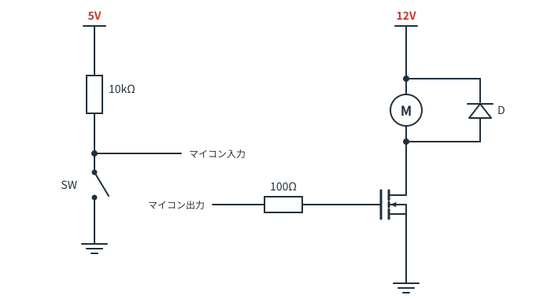
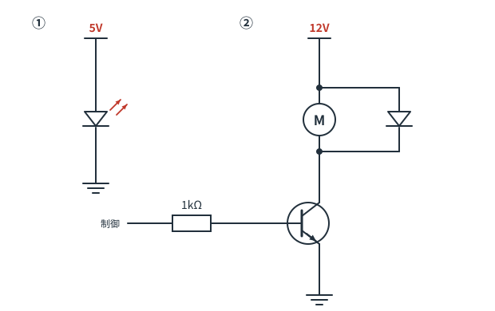

# 第10章　総合演習 — 回路図を読み解く

ここまでの知識を総動員します。
**答えを見る前に、必ず自分の言葉で説明を組み立ててみてください。**
「この線をたどると…」と指でなぞりながら読むのが上達のコツです。

---

## 演習A：回路全体を読む

次の回路図を読んでください。マイコン（Arduinoなど）につながる想定です。



**A-1.** この回路には、大きく分けて2つの部分があります。それぞれ何をする部分ですか。

<details>
<summary>解答を見る</summary>

- **左側**：プルアップ抵抗（10kΩ）＋スイッチによる**入力回路**。ボタンの押下をマイコンに伝える
- **右側**：MOSFETによる**出力回路**（ローサイドスイッチ）。12Vのモータを、マイコンの信号でON/OFFする

つまり全体としては、**「ボタンを押したらモータを回す」ための回路**です。

</details>

**A-2.** ボタンを押していないとき、「マイコン入力」の電圧は何Vですか。押すと何Vになりますか。

<details>
<summary>解答を見る</summary>

- 押していないとき：10kΩを通って5Vにつながっている → **5V（HIGH）**
- 押したとき：スイッチでGNDに直結される → **0V（LOW）**

（プルアップなので論理が反転している点に注意）

</details>

**A-3.** 「マイコン出力」を HIGH にすると何が起きますか。

<details>
<summary>解答を見る</summary>

ゲートに電圧がかかって **MOSFETがON** → ドレイン‐ソース間がつながる →
12V電源からモータを通ってGNDへ電流が流れ、**モータが回ります**。

</details>

**A-4.** D は何ですか。もし外したらどうなりますか。

<details>
<summary>解答を見る</summary>

**還流ダイオード**です。

外すと、MOSFETをOFFにした瞬間にモータのコイルが発生させる逆起電力（数十〜数百V）が
MOSFETのドレインにかかり、**MOSFETが破壊されます**。
「最初は動くのに、しばらく使っていると壊れる」という症状の典型的な原因です。

</details>

**A-5.** ゲートの前に入っている 100Ω は何のためですか。

<details>
<summary>解答を見る</summary>

**ゲート抵抗**です。MOSFETのゲートは小さなコンデンサのように振る舞うため、
ON/OFFの瞬間にマイコンの出力ピンから大きな突入電流が流れます。それを制限してピンを保護します。
また、急激なスイッチングによるノイズ（リンギング）を抑える効果もあります。

</details>

**A-6.** この回路にはGNDが複数描かれています。5Vの電源と12Vの電源のGNDは、つないでよいですか。

<details>
<summary>解答を見る</summary>

**つなぐ必要があります**（共通グラウンド）。

マイコンが出す「5V」という信号は、あくまでマイコン側のGNDから見た5Vです。
MOSFETのソースが12V電源側のGNDにつながっているので、両者のGNDが共通でないと、
ゲート‐ソース間に何ボルトかかっているのかが定まらず、MOSFETは正しく動きません。

</details>

---

## 演習B：間違い探し

次の2つの回路には、それぞれ**危険な間違い**があります。見つけて、何が起きるか説明してください。



<details>
<summary>解答を見る</summary>

### ① LEDに電流制限抵抗がない

5V電源にLEDが直結されています。
LEDのVf（約2V）を超えた瞬間、電流を制限するものが何もないため過大な電流が流れ、**LEDが焼損します**。

**修正**：直列に抵抗を入れる。5V・10mAなら `(5 − 2) ÷ 0.01 = 300Ω` → 330Ω。

### ② 還流ダイオードの向きが逆

ダイオードが電源に対して**順方向**に接続されています。
これでは電源を入れた瞬間、モータを通らずにダイオードを通って大電流が流れ、
**ダイオードが焼損し、電源もショート状態**になります。

**修正**：ダイオードを逆向きに（カソード＝棒側を＋電源側に）付ける。
ふだんは電流を流さず、OFFの瞬間だけ逆起電力の逃げ道になるのが正しい姿です。

</details>

---

## 演習C：計算を伴う読み取り

**C-1.** 5V電源、LEDのVf = 2.0V、直列抵抗 220Ω のとき、LEDに流れる電流は？ 明るさとして妥当ですか。

<details>
<summary>解答を見る</summary>

```
I = (5 − 2.0) ÷ 220 = 0.0136A ≈ 13.6mA
```

一般的なLEDの定格は20mA前後なので、**妥当な明るさ**です（十分明るく光ります）。

</details>

**C-2.** 12Vのバッテリーの電圧を、3.3VのマイコンのADCで測りたい。分圧回路の抵抗値を決めてください。

<details>
<summary>解答を見る</summary>

12V が 3.3V 以下になればよいので、**1/4 以下**にします。安全のため 1/5 くらいにしましょう。

例：R1 = 40kΩ、R2 = 10kΩ とすると
```
Vout = 12 × 10k / (40k + 10k) = 2.4V
```
3.3V以内に収まり、余裕もあります。

市販の値でそろえるなら **R1 = 39kΩ、R2 = 10kΩ**（Vout = 2.45V）などが実用的です。
この分圧に常時流れる電流は `12 ÷ 49k ≈ 0.24mA` で、バッテリーの消耗もわずかです。

> プログラム側では、読んだ電圧を約5倍して元の電圧に換算します。

</details>

**C-3.** 「10kΩ と 0.1µF のRCフィルタ」の時定数は？ どのくらいの速さの信号まで通せますか。

<details>
<summary>解答を見る</summary>

```
τ = 10kΩ × 0.1µF = 10 × 0.1 = 1ms
```

目安として、**時定数より十分ゆっくりした変化（数百Hz以下）は通り、それより速い変化は減衰**します。
ボタンのチャタリング除去や、センサ信号のノイズ取りにちょうどよい値です。

</details>

---

## 演習D：設計してみる

**D-1.** 「暗くなったらLEDが点灯する回路」を作りたい。必要なパターンを組み合わせて、構成を説明してください（回路図は描けなくてOKです。ブロックで説明してください）。

<details>
<summary>解答を見る</summary>

構成例：

1. **CdSセル＋抵抗の分圧回路**（パターン④）で、明るさを電圧に変換
2. その電圧を**マイコンのADCで読む**
3. 一定値より暗ければ、マイコンが出力ピンをHIGHにする
4. **トランジスタ（ローサイドスイッチ、パターン⑤）**でLEDをON
5. LEDには**電流制限抵抗**（パターン①）

LEDが1個で消費電流が小さいなら、③④をまとめてマイコンのピンから直接LEDを駆動しても構いません（20mA以内なら）。

> マイコンを使わずアナログだけで作ることもできます（分圧の出力をトランジスタのベースに直接つなぐ）。
> その場合は、しきい値付近でぼんやり点灯する挙動になります。

</details>

**D-2.** 12V・1A のDCモータを、5Vマイコンで回したい。必要な部品を全部あげてください。

<details>
<summary>解答を見る</summary>

- **Nチャネル MOSFET（ロジックレベル品）** — 1A を余裕で扱える定格のもの
- **ゲート抵抗**（100Ω程度）
- **ゲートのプルダウン抵抗**（10kΩ程度）
- **還流ダイオード** — 1A以上流せるもの（ショットキーが望ましい）
- **12V電源**と、5Vマイコン電源との**共通GND**
- （推奨）12V電源ラインとGNDの間に**平滑用の電解コンデンサ**。モータの起動時に電圧が落ち込むのを緩和する

正転・逆転もさせたい場合は、MOSFET 4個を使う **Hブリッジ回路**、または市販のモータドライバICを使います。

</details>

---

## 修了チェックリスト

次のことが「見た瞬間にわかる」ようになっていれば、この教材は卒業です。

- [ ] 回路図の中の電源とGNDを見つけられる
- [ ] ● の有無で接続を判断できる
- [ ] 直列か並列かを見分けられる
- [ ] 抵抗2本＋中間の線を見て「分圧」と言える
- [ ] LEDの直列抵抗の値から電流を暗算できる
- [ ] プルアップを見て「押すとLOW」と言える
- [ ] 「負荷 → トランジスタ → GND」を見て「ON/OFF回路」と言える
- [ ] コイルの逆向きダイオードを見て「逆起電力対策」と言える
- [ ] 信号線からGNDに降りるコンデンサを見て「ノイズ取り」と言える

---

⬅️ [第9章](ch09-patterns.md) ／ [目次](README.md) ／ ➡️ [第11章：付録](ch11-appendix.md)
